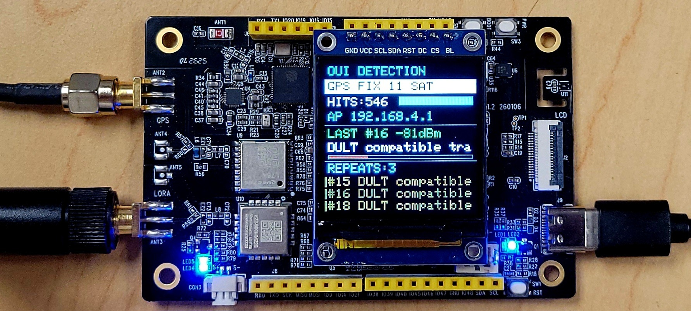
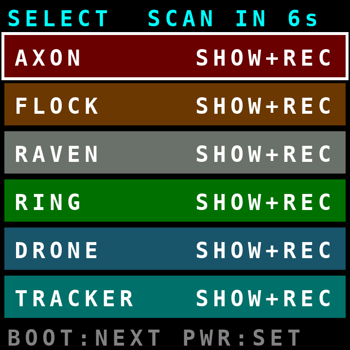
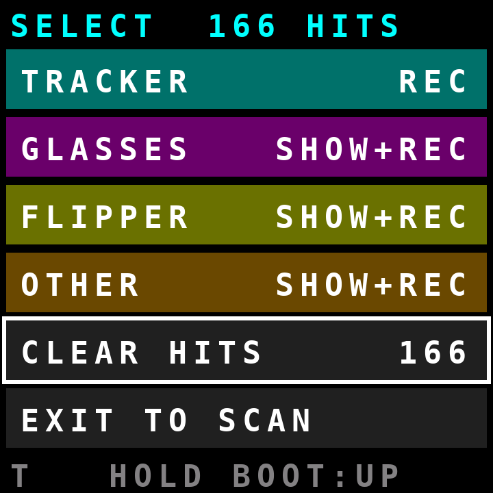
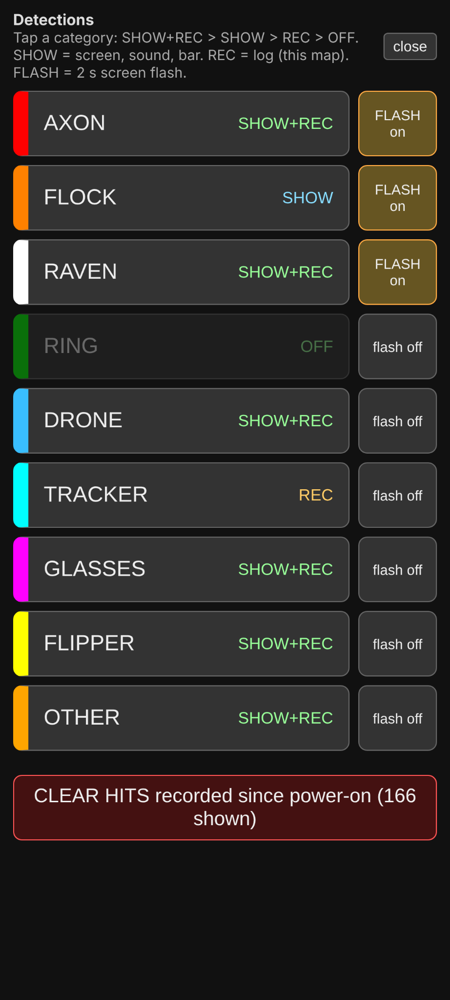
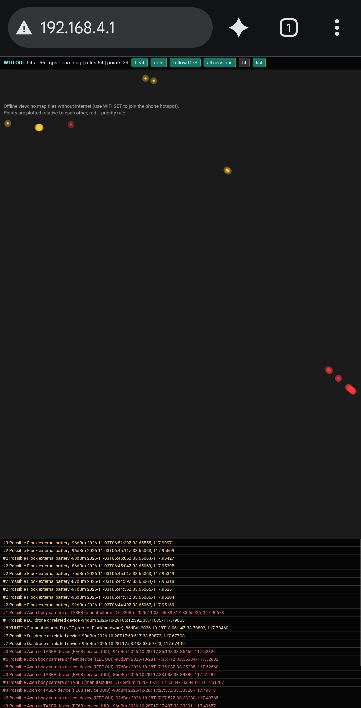
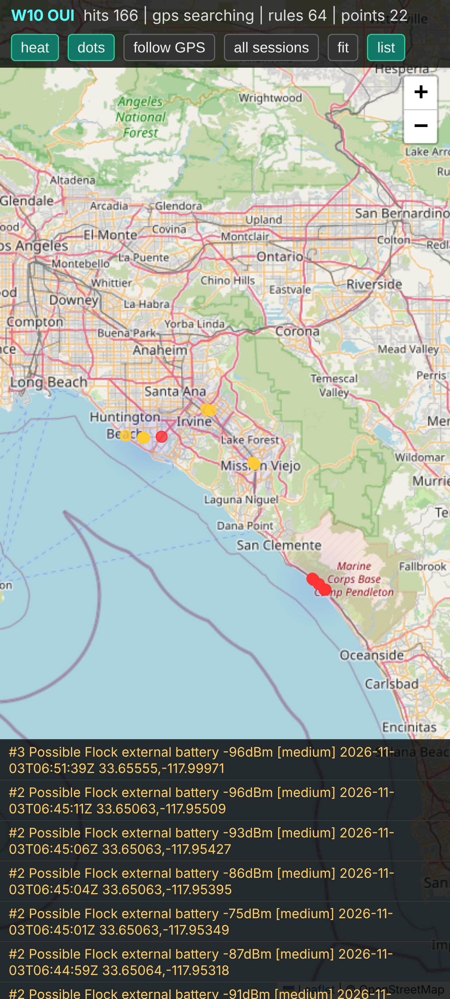
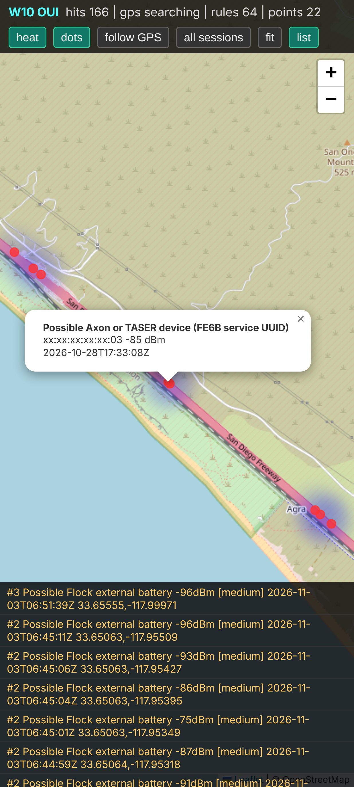
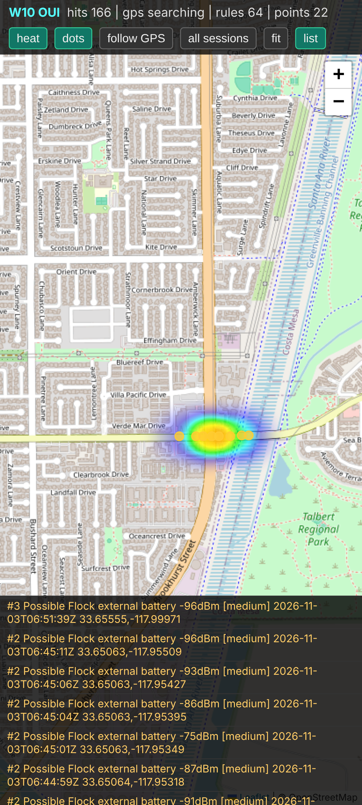

# W10 OUI Detection

ESP32-S3 BLE detection, SX1262 sub GHz RADIO and LoRa reception, GPS logging and browser mapping for the Meshnology W10.

Initial release: v0.4.20 · BLE detection rules: 64 · Hardware: Meshnology W10 (ESP32-S3 + SX1262)

Version 0.4.20 is the initial public release of W10 OUI Detection, combining BLE signature detection with receive only SX1262 radio activity monitoring and LoRa packet reception. The BLE/GPS detector has been used successfully on real world wardrives; the included photographs and maps document that field use. The SX1262 features are present in the supplied firmware, but the SX1262 radio paths have not been independently tested on the hardware during repository preparation.

Included speaker: The W10 includes a speaker. Although it is not shown in the hardware photo above, the firmware uses it for audible detection alerts through the ES8311 codec and I2S audio.

## Detection controls and alerts

- Physical button selection menu: Use the W10's BOOT and PWR keys to configure detection behavior on its TFT display.
- Eleven detection categories: AXON, FLOCK, RAVEN, RING, DRONE, TRACKER, GLASSES, FLIPPER, RADIO, LORA and OTHER. RADIO and LORA appear before OTHER on the W10 menu, USB SELECT and browser Select panel.
- Per category mode: Cycle SHOW+REC → SHOW → REC → OFF. Settings persist in NVS across restarts.
- Startup menu: Displays for 8 seconds at startup; a key press keeps it open. It automatically closes after 25 seconds without a key press.
- Repeat suppression: A tracked device produces another report no sooner than 60 seconds after the previous report. Incoming packets still update signal strength.
- Flash alerts: Optional two second category colored screen flashes; enabled by default for AXON, FLOCK, RAVEN and RADIO. Low confidence LoRa matches do not trigger sound or screen flash.
- Long text ticker: Strings exceeding 19 characters hold for 1.2 seconds, then scroll one character every 220 milliseconds, with a gap before repeating.
- Controls everywhere: Change category modes through the W10 screen, the browser's Select menu or USB serial.
- Clear hits: Two step confirmation on the device; clears current counts, hit bar and device table, and removes the current startup session log.

### W10 display: selection menu

The screenshots below illustrate the menu design during development. They show the earlier nine category arrangement; the v0.4.20 initial public release includes RADIO and LORA before OTHER, bringing the total to 11 categories.

| Menu at startup | Menu scrolled to lower categories |
|:---:|:---:|
| [](docs/images/W10_menu_powerup.png) | [](docs/images/W10_menu_scrolled.png) |

### Browser selection controls

[](docs/images/W10_web_detection_selection.png)

W10 buttons: BOOT = next row · hold BOOT = previous row · press PWR = select/toggle · hold PWR about 1 second = exit menu · hold PWR about 4 seconds = power off.

The per category modes mean:

| Mode | Device display, sound and hit bar | USB JSON, flash log and plotted map |
|---|---|---|
| SHOW+REC | Yes | Yes |
| SHOW | Yes | No |
| REC | No | Yes |
| OFF | No; match discarded before tracking | No |

Counter behavior: The HITS and hit bar show reports generated for categories with SHOW enabled; the hits field in logged events counts reports for a tracked device, while packets counts raw packets. The 60 second repeat window prevents several packets received in quick succession from inflating reported hits.

Read the [complete menu, flash and ticker guide](docs/USER_INTERFACE.md).

## SX1262 RADIO and LoRa monitoring

The W10's SX1262 is operated in receive only mode alongside the ESP32-S3 BLE scanner. RADIO and LORA have their own saved SHOW+REC, SHOW, REC and OFF selections.

### RADIO: nearby transmitter activity

- Default monitored bands: 799.5–805.5 MHz and 806.0–813.5 MHz, sampled at 0.4 MHz intervals. The firmware alternates RF energy sampling with LoRa channel activity checks and BLE processing; approximately ten sweeps per second is the intended operating cadence, not a guaranteed measured rate; the actual rate depends on activity and scheduling.
- Detection condition: a measured RSSI of at least −70 dBm, also at least 20 dB above the learned floor for that frequency step, after the initial floor learning sweeps.
- Reporting: a RADIO hit such as Radio keyed 810.2 MHz, displayed in violet. It uses priority audio and screen flashing by default, is suppressed to one report per frequency per 60 seconds, and may be saved with GPS to USB/LittleFS JSON and plotted on the map.
- Interpretation: a hit signifies possible nearby RF transmission, not confirmed police presence, a decoded voice call or a verified radio identity. Police, fire, transit, public works and other users may share nearby allocations. For example, Southern California users may consult frequency listings for San Diego County RCS or Orange County systems in [RadioReference](https://www.radioreference.com/), but the firmware does not automatically query that database or identify the agency.
- Tuning: SUBG SCAN prints recent RSSI and learned noise floor by step; SUBG THRESHOLD &lt;dBm&gt; adjusts the threshold; SUBG BAND ADD &lt;lo&gt; &lt;hi&gt; [name] adds a monitored range (within the chip's configured 150–960 MHz limit).

### LORA: passive channel activity and packet reception

- Meshtastic US LongFast: default profile 906.875 MHz (250 kHz bandwidth, SF11). When a compatible frame is received, the detector can read the originating node ID from its unencrypted header; it does not decrypt protected message payloads.
- LoRaWAN US915 subband 2: default profiles for 903.9–905.3 MHz (125 kHz uplink channels) and 904.6 MHz (500 kHz). Compatible join requests can expose a DevEUI and its apparent maker prefix; data frame headers can expose a DevAddr.
- Detection behavior: channel activity detection (CAD) precedes packet reception. LORA observations are low confidence and can be logged and GPS plotted without audible alerts or screen flash.
- Configuration: SUBG LORA ADD accepts other profiles, including frequency, bandwidth, spreading factor, coding rate, sync word and decoder type. SUBG, STATUS and web status show the SX1262 state.

Both functions are passive receive and observation only. RADIO energy detection does not decode public safety P25 voice or prove a transmitter's role; LoRa reception covers only the profiles scanned and packets actually captured.

See [SX1262 scanning and command reference](docs/SX1262_RADIO_LORA.md).

## Field screenshots

| Live browser detections | Regional GPS detection map |
|:---:|:---:|
| [](docs/images/w10-browser-live-detections.png) | [](docs/images/w10-map-overview.png) |

| Camp Pendleton wardrive | Costa Mesa detection heat map |
|:---:|:---:|
| [](docs/images/w10-map-camp-pendleton.png) | [](docs/images/w10-map-costa-mesa.png) |

## Connect to the W10

| Item | Default |
|---|---|
| Wi-Fi network (SSID) | W10-OUI |
| Wi-Fi password | w10detect |
| Browser dashboard and GPS map | http://192.168.4.1 |

Power on the W10, connect a phone or computer to W10-OUI using w10detect, then open http://192.168.4.1. In the browser, choose Select to change category modes and flash settings. You can also connect the W10 to a phone hotspot and open the IP displayed on the W10, or http://w10.local if mDNS resolves.

The W10 itself hosts the dashboard. An internet connection may be necessary to load external map tiles and scripts. Change the default Wi-Fi password for personal use: access to the network also allows access to its web interface and recorded detections.

## Features

- Receive only SX1262 scanning: RF energy monitoring in configured public safety mobile transmit ranges, with LoRa CAD and packet reception.
- Passive BLE scanning: Watchlist matcher supports OUI, MAC, CID, service UUID, 128 bit UUID, advertised name and composite Meta signatures.
- 64 built in rules: 30 original entries, 4 Flock related additions, 2 Axon service additions and 28 additional BLE signatures; maximum watchlist capacity 160.
- GPS tagged detections: Location, UTC time, speed, heading, satellites and fix diagnostics when available.
- Local JSON records: USB serial NDJSON and LittleFS logs with session listing and export commands.
- Mapped history: Browser detections, saved sessions, plotted points and heat maps.
- Display/audio alerts: TFT, RGB indicators and W10 speaker with configurable per category appearance and sound behavior, including RADIO priority alerts.
- Diagnostics and configuration: Scan watchdog, BLE quality metrics, self tests, saved aliases, watchlists and Wi-Fi settings.

## Hardware and software

Target: Meshnology W10 development kit with ESP32-S3, 16 MB flash, TFT display, GNSS, SX1262 radio and onboard power/audio hardware. This is a W10 specific build, not a direct replacement sketch for generic ESP32-S3 boards.

### Required libraries and versions

| Library | Version | Source |
|---|---|---|
| ESP32 Arduino core (esp32 by Espressif) | 3.3.12 | Boards Manager, URL https://raw.githubusercontent.com/espressif/arduino-esp32/gh-pages/package_esp32_index.json |
| NimBLE-Arduino (h2zero) | 2.5.2 | Library Manager |
| TinyGPSPlus (Mikal Hart) | 1.0.3 | Library Manager |
| GFX Library for Arduino (Moon On Our Nation) | 1.6.9 | Library Manager |
| Adafruit MCP23017 Arduino Library | 2.3.2 | Library Manager (pulls in Adafruit BusIO) |
| es8311 | Meshnology W10 vendor release | Add .ZIP Library, from the W10 wiki libraries package |

Bundled with the ESP32 core (no separate installation): WiFi, WebServer, ESPmDNS, ESP_I2S, LittleFS, FS, Preferences, Wire, SPI.

Do not install a separate AudioI2S or XPowersLib. The sketch drives the AXP2101 directly.

### Arduino IDE Tools menu: ESP32S3 Dev Module

| Setting | Value |
|---|---|
| Board | ESP32S3 Dev Module |
| USB CDC On Boot | Enabled |
| USB Mode | Hardware CDC and JTAG |
| CPU Frequency | 240 MHz |
| Flash Mode | QIO 80 MHz |
| Flash Size | 16 MB (128 Mb) |
| Partition Scheme | Custom (reads partitions.csv from the sketch folder) |
| PSRAM | OPI PSRAM |
| Upload Speed | 921600 (drop to 460800 if uploads fail) |
| Upload Mode | UART0 / Hardware CDC |
| Core Debug Level | None |
| Erase All Flash Before Sketch Upload | Disabled |
| Arduino Runs On / Events Run On | Core 1 (default) |
| JTAG Adapter, Zigbee Mode | default / Disabled |

### Open in Arduino IDE

1. Download or clone this repository.
2. Open W10_OUI_DETECTION_0_4_20/W10_OUI_DETECTION_0_4_20.ino in Arduino IDE. Keep partitions.csv in that same sketch folder.
3. Install the specified ESP32 core and libraries, select ESP32S3 Dev Module, and apply the settings above.
4. Compile and upload the sketch. Open Serial Monitor at 115200 baud.
5. Use HELP, STATUS, SELECT, SUBG or SCAN QA for status and commands, or connect to W10-OUI and open http://192.168.4.1.

Partition caution: The supplied partitions.csv is intended for the 16 MB flash configuration. Flash formatting or partition changes may erase saved logs.

## Serial commands: quick examples

```text
SELECT
SELECT FLOCK SHOW
SELECT TRACKER REC
SELECT ALL ON
SELECT FLASH RADIO ON
SUBG
SUBG SCAN
SUBG THRESHOLD -70
SUBG BAND ADD 450 470 UHF
SUBG LORA ADD 915.0 125 10 5 34 2 Example
HITS CLEAR
MENU
WATCH LIST
WATCH REPO MERGE
WIFI STATUS
LOG LIST
```

See [all serial commands](docs/SERIAL_COMMANDS.md), [SX1262 radio/LoRa reference](docs/SX1262_RADIO_LORA.md), [user interface guide](docs/USER_INTERFACE.md) and [64 BLE detection identifiers](docs/DETECTION_IDENTIFIERS.md).

## Repository contents

```text
W10-OUI-Detection/
├── README.md
├── .gitignore
├── W10_OUI_DETECTION_0_4_20/
│   ├── W10_OUI_DETECTION_0_4_20.ino
│   └── partitions.csv
└── docs/
    ├── DETECTION_IDENTIFIERS.md
    ├── SERIAL_COMMANDS.md
    ├── USER_INTERFACE.md
    ├── SX1262_RADIO_LORA.md
    ├── SECURITY_REVIEW.md
    └── images/
        ├── w10-hardware.jpg
        ├── W10_menu_powerup.png
        ├── W10_menu_scrolled.png
        ├── W10_web_detection_selection.png
        ├── w10-browser-live-detections.png
        ├── w10-map-overview.png
        ├── w10-map-camp-pendleton.png
        └── w10-map-costa-mesa.png
```

## Detection accuracy and privacy

Detection is based on possible BLE signature matches, not independently verified identification of a particular product or device. Randomized MACs, reused manufacturer IDs and spoofed BLE payloads can affect interpretation. In particular CID 09C8 identifies XUNTONG, not proof of Flock Safety hardware. Priority tiers are rule labels, not calibrated accuracy percentages.

The default W10 AP password is shared across fresh devices, and v0.4.20's HTTP API permits both reading location logs and changing modes/clearing hits without authentication. Only connect from trusted devices and change the default password on your own W10. Never publish raw GPS .jsonl captures casually. The dashboard fetches external mapping assets that may reveal the browser's viewed map area. Read [security and personal privacy notes](docs/SECURITY_REVIEW.md).
