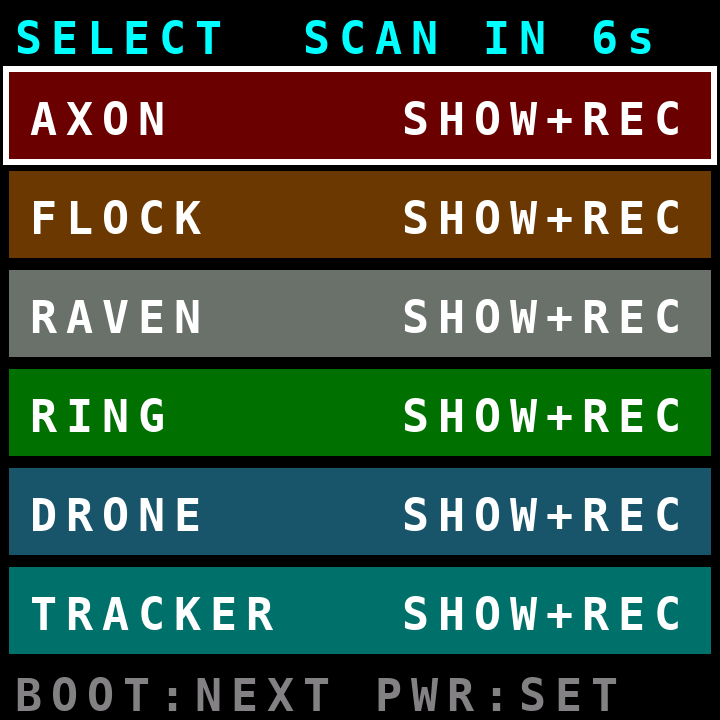
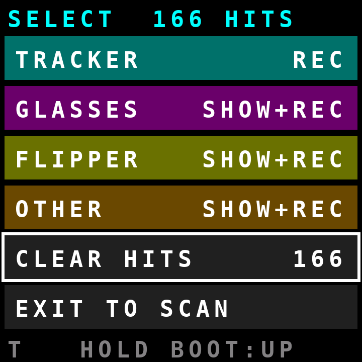
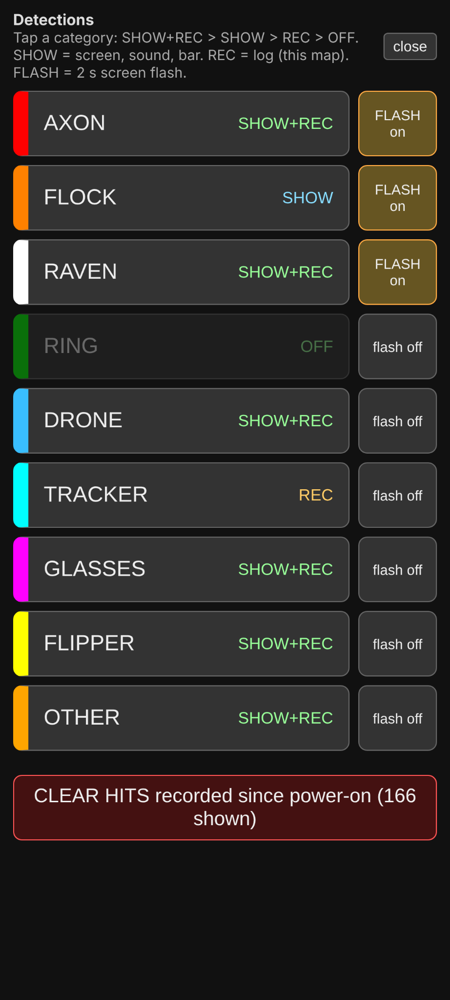

# W10 v0.4.20: two-button menu, category modes and alerts

The W10 is operated through the BOOT and PWR keys; the hardware display is not a touch panel. The mobile browser provides a separate touch friendly Select menu.

## On-device keys

| Input | Menu behavior |
|---|---|
| Press `BOOT` | Open the menu from scan view; otherwise move to the next row |
| Hold `BOOT` | Move to the previous menu row |
| Short press `PWR` | Open the menu from scan view, or select/toggle the highlighted row |
| Hold `PWR` ~1 second | Exit menu to scanning |
| Hold `PWR` ~4 seconds | Power off the W10 through its existing power management behavior |

The menu opens automatically at boot with a SCAN IN 8s countdown and shows the saved modes. If no key is pressed, scanning view replaces it after eight seconds. Any key interaction cancels the countdown. It closes after 25 seconds of inactivity; BOOT or PWR opens it again later.

These developmental screenshots show the previous nine category layout; v0.4.20 has 11 categories.

| Top of menu | Bottom of menu |
|---|---|
|  |  |

## Categories and modes

The eleven categories are AXON, FLOCK, RAVEN, RING, DRONE, TRACKER, GLASSES, FLIPPER, RADIO, LORA, OTHER. Each category cycles SHOW+REC → SHOW → REC → OFF.

| Mode | Screen, speaker, bar and displayed HITS | JSON to USB and LittleFS, viewable on web map |
|---|---|---|
| `SHOW+REC` | On | On |
| `SHOW` | On | Off |
| `REC` | Off | On |
| `OFF` | Off, match rejected before tracking | Off |

Mode and flash selections are saved immediately in ESP32 NVS and survive reboot. On first use all 11 categories default to SHOW+REC; the example browser screenshot shows user-adjusted selections in an earlier nine category interface. The initial public release includes RADIO and LORA before OTHER.

## Clear hits

Select CLEAR HITS; the W10 asks CLEAR? PWR=YES. Press PWR a second time to clear current counters, the bar and device table, and delete the current startup session log file. Previously saved sessions are not intentionally deleted by this command. The equivalent serial command is `HITS CLEAR`. The browser has a CLEAR HITS button with a confirmation dialog. Clearing hits is destructive for the active session and cannot be undone from the device.

## 60 second repeat rule

A tracked device is reported again only when at least 60 seconds have elapsed since its last report. Packets arriving sooner refresh signal readings without creating another report. Thus eight advertisement packets received in twenty seconds generally contribute only one report for that tracked device. Logs distinguish `hits` (per-device reports) and `packets` (raw packets received).

The visible total HITS indicator and hit bar reflect reports from categories with display enabled, not the total number of raw BLE packets and not necessarily all REC-only logged events.

## Category-colored screen flash

Per category FLASH controls are available in the web Select panel or by serial. AXON, FLOCK, RAVEN and RADIO have FLASH enabled by default; all others default off.

A qualifying report alternates the whole display between the category color and black every 125 ms, for two seconds, and then redraws the scan screen. This amounts to eight color transitions per second (four complete color/black cycles per second). Flash follows the 60 second report rule. Low confidence detections can still count/log but do not flash or play a detection sound.

## Scrolling ticker

Text longer than 19 display characters is held at the beginning for 1.2 seconds and then scrolls one character every 220 ms. The ticker loops after a three-character gap. Updated detection text restarts its scroll from the beginning.

## Web interface

The browser menu works on a phone or computer after connecting to Wi-Fi W10-OUI with default password w10detect, then opening http://192.168.4.1. Select Select to open the categories and individual flash buttons.



Privacy: Web selection changes and clearing actions are not authenticated in the current firmware. Anyone with network access to the dashboard can perform them. Changing the AP password helps restrict casual nearby access.

## USB serial equivalents

At 115200 baud, send one command per line:

```text
SELECT                     # view categories and selections
SELECT FLOCK SHOW          # visual + sound only, not logged
SELECT TRACKER REC         # USB JSON and flash log only
SELECT ALL ON              # every category SHOW+REC
SELECT FLASH RADIO ON      # enable RF activity flashes
SELECT RADIO SHOW+REC      # display, alert and record RF observations
SELECT LORA REC            # log LoRa frames without sounds
SELECT FLASH FLOCK OFF     # disable Flock flash
HITS CLEAR                 # clear active hits/session data
MENU                       # open/close the W10 display menu
```

See [serial commands](SERIAL_COMMANDS.md) and [SX1262 guide](SX1262_RADIO_LORA.md) for remaining commands.
